
<a href="https://github.com/SamerAlTaki97/institute-quality-showcase/releases/latest">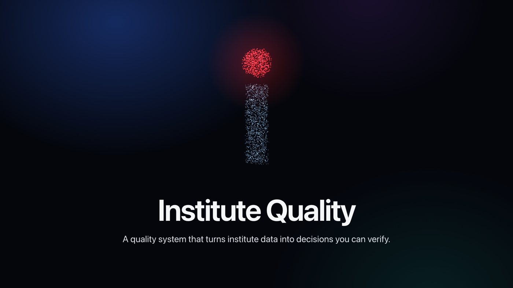</a>

<h1 align="center">Institute Quality</h1>

<strong>A quality system that turns institute data into decisions you can verify.</strong> 
<a href="https://github.com/SamerAlTaki97/institute-quality-showcase/releases/latest">Watch the 3-minute video (English and Arabic)</a>

> Every institute has numbers. Few have decisions. Institute Quality finds the problem, gives it an owner, and measures whether the fix worked.

**Contents:** [The problem](#the-problem) · [The idea](#the-idea) · [A problem from start to finish](#a-problem-from-start-to-finish) · [Product tour](#product-tour) · [Who uses it](#who-uses-it) · [How scores work](#how-scores-work) · [AI assistant](#ai-assistant) · [Trust and privacy](#trust-and-privacy) · [Programming skills](#programming-skills) · [Status](#status)

## The problem

Educational institutes collect plenty of data: enrollments, attendance, payments, assessments, leads, and classroom observations. It usually lives in separate files, and three things tend to go wrong:

- **Reports arrive late.** By the time someone compiles them, the moment to act has passed.
- **Problems have no owner.** Everyone can see a number, but nobody is responsible for changing it.
- **Nobody checks the result.** A decision gets made, and it's unclear whether it worked.

## The idea

The system is built around one closed loop. Every feature serves one of its six steps.

| Step | What happens | Why it matters |
|---|---|---|
| **1. Data** | Upload one Excel file. The system checks it and shows the result before you confirm. | Bad data is caught before it affects any number. |
| **2. Signal** | 22 detection rules look for problems, with their size and records. | Problems surface without anyone having to search. |
| **3. Decision** | Each decision gets one owner, a deadline, and a measurable target. | Responsibility is clear from the start. |
| **4. Action** | Clear steps appear in each person's tasks. | Work reaches the people who do it. |
| **5. Verification** | Someone who did not do the work confirms it was done. | The result doesn't rest on self-reporting. |
| **6. Impact** | Before and after numbers show whether the decision worked. | The institute learns what actually works. |

## A problem from start to finish

Here is one example, using the test data:

1. **The signal appears.** The system finds 602 enrollments with an unpaid balance, worth 696,920 AED.
2. **You check the evidence.** A press opens the exact records behind the number.
3. **You decide.** You choose a proposed action or write your own, then set an owner, a deadline, and a target. The AI assistant can suggest causes and options.
4. **The team acts.** Steps appear in each person's tasks, and late work stands out.
5. **Someone else verifies.** A different person confirms the work was done.
6. **The system measures.** The new number is compared with the starting number and the target, and the result goes into the report.

## Product tour

### Quality center: where you stand, and what to do first
All six departments on one screen, with a one-sentence reading of the current state and the work that needs you now.

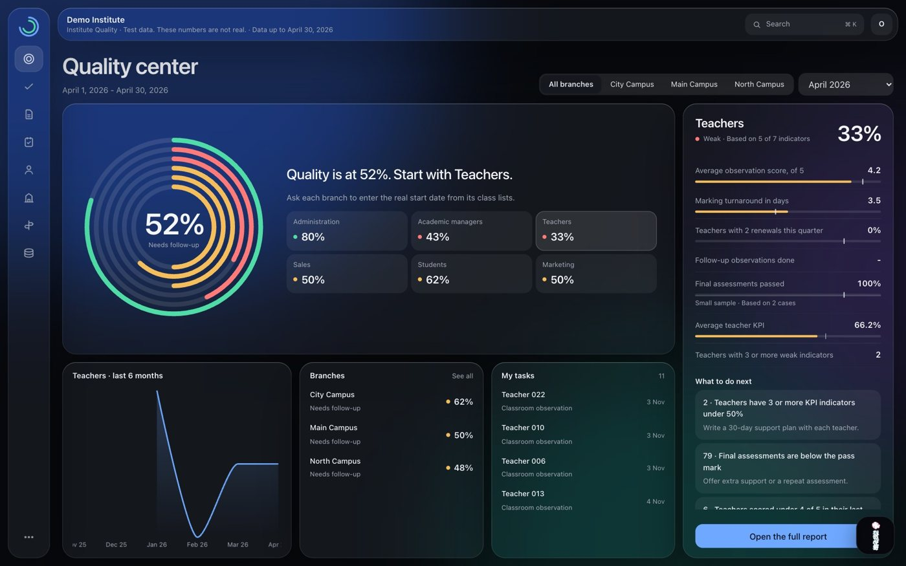

### Interactive overview: press anything
Press any part of a chart, and the whole page filters by year, period, branch, course, status, teacher, or attendance level. The filters stay in the link, so a view is easy to share with a colleague who has access.

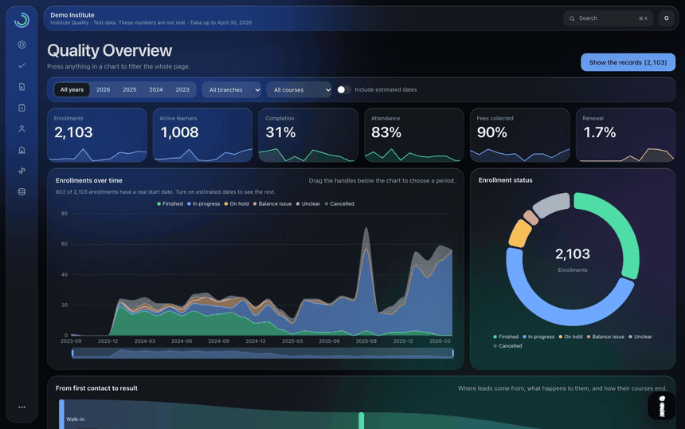

The dashboard follows the path from first contact to result, and adds a teacher performance map, courses and levels, enrollment seasons, and fees by branch.

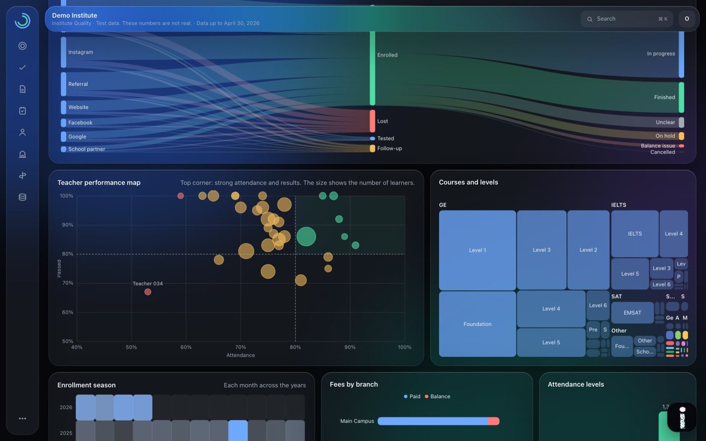

### Branches: a real map of the UAE
A 3D map you can turn by dragging, with a column for each branch. The height can show learners, teachers, or quality. Pressing a column opens that branch's details.

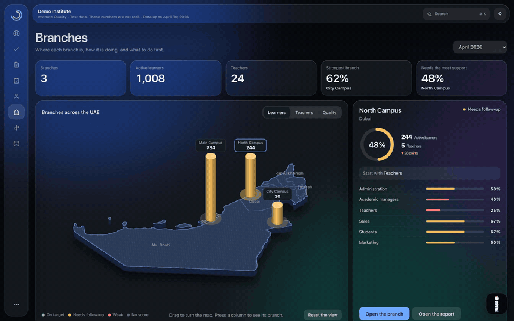

Below the map, towers compare every department in every branch, and short sentences say where to start.

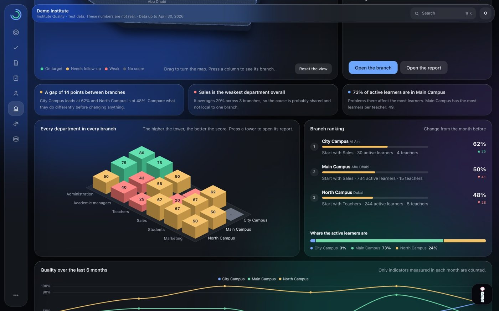

### Sales: from lead to result
The full journey from lead to renewal, lead sources, reasons for losing leads, and a map of consultants.

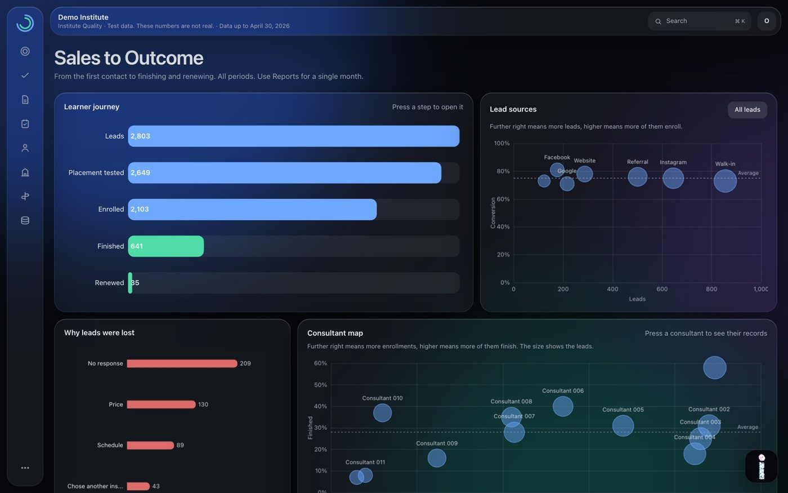

### Decisions: no problem without an owner
Signals, evidence, proposed actions, and the full decision cycle in one place, with filters for status, importance, owner, branch, and deadline.

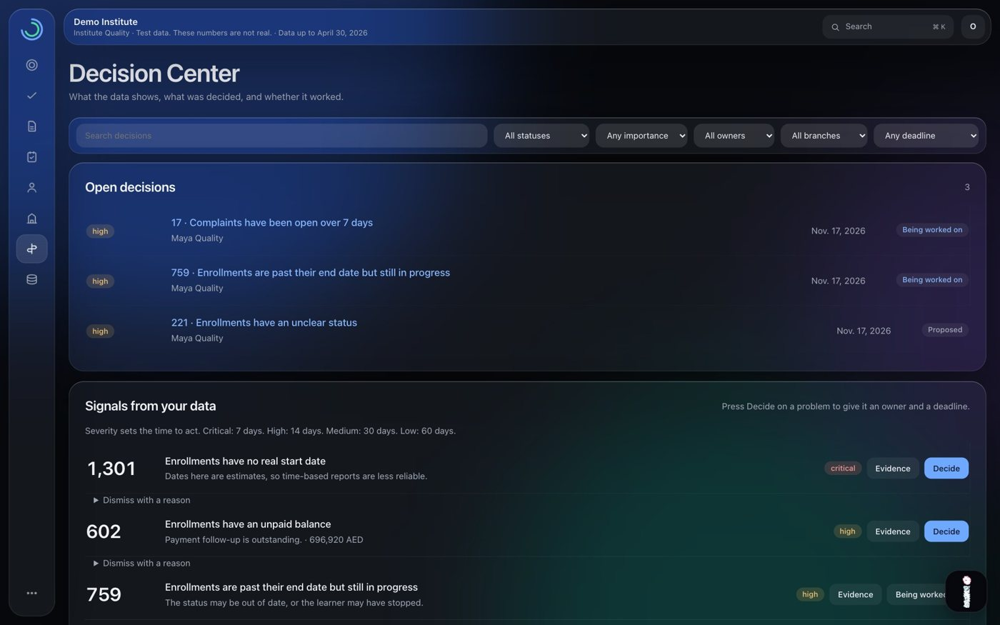

### Teachers: a development page for each person
Observation history, the result of each item, a comparison with the team, the teacher's courses, strengths, and what to work on next. Classroom observations are filled in inside the system.

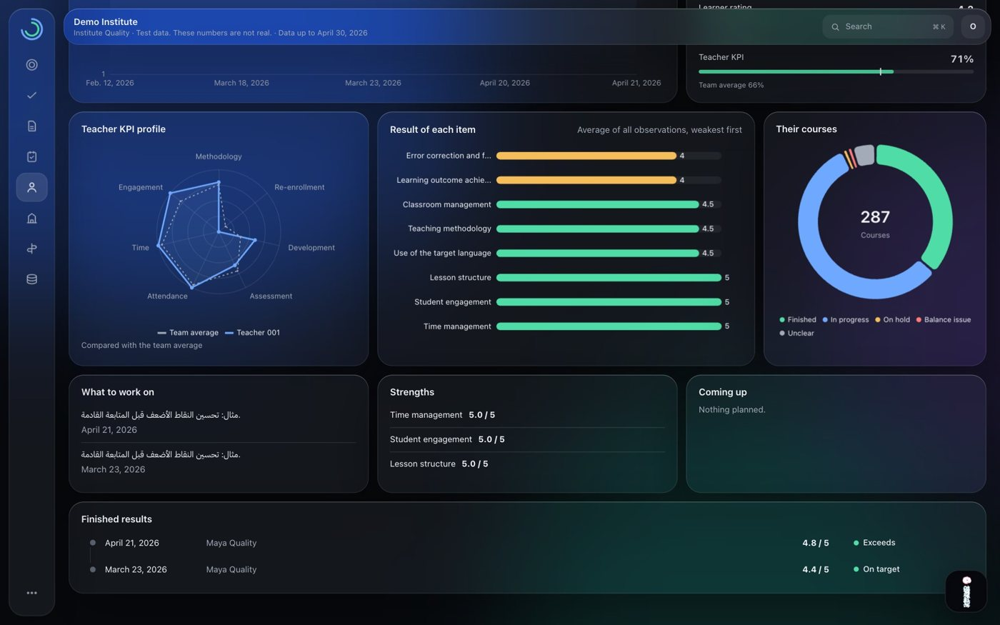

### Records: find anything fast
Filter by status, branch, course, level, teacher, consultant, year, balance, and date type, and open any record to trace it from sales to report.

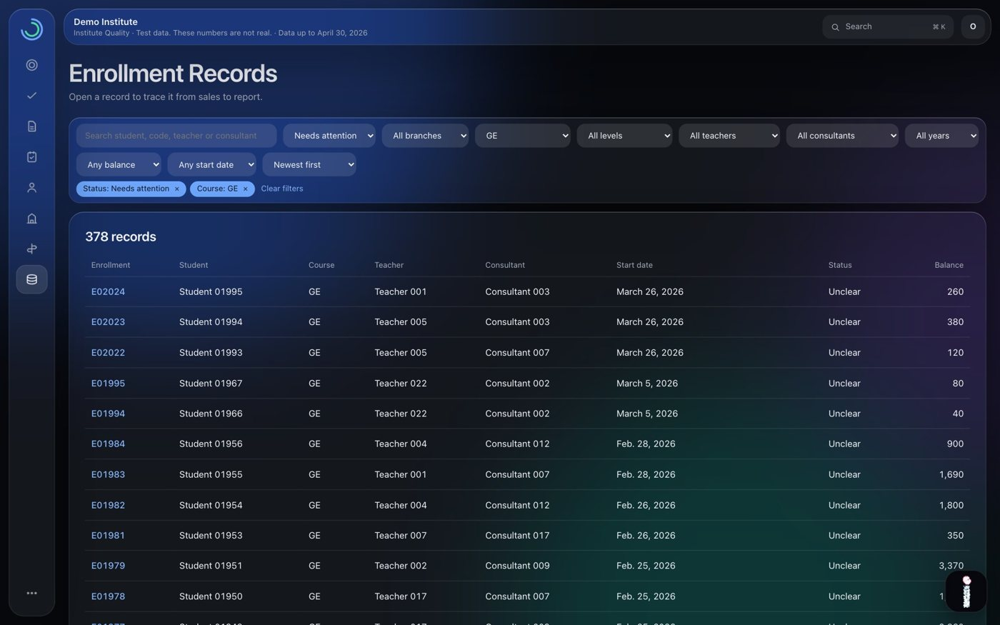

### Reports: ready for management
For the whole institute, each branch, or each department, monthly or on demand. Each one includes a cover, summary, priorities, department results, proposed actions, and a sign-off area. They export to PDF and Excel, and issued reports never change.

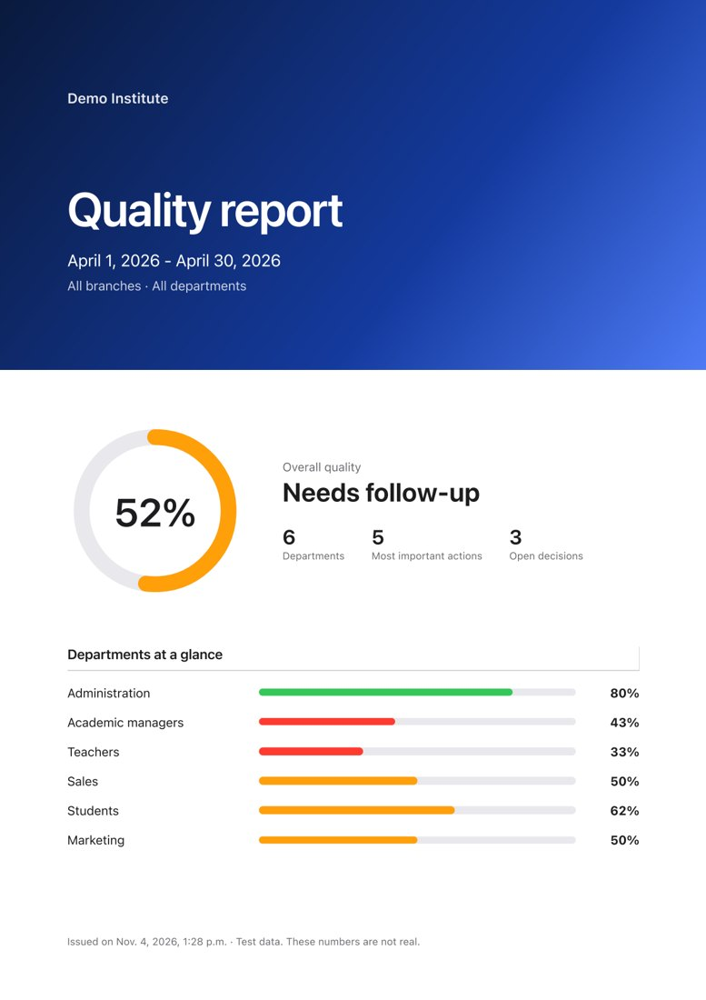 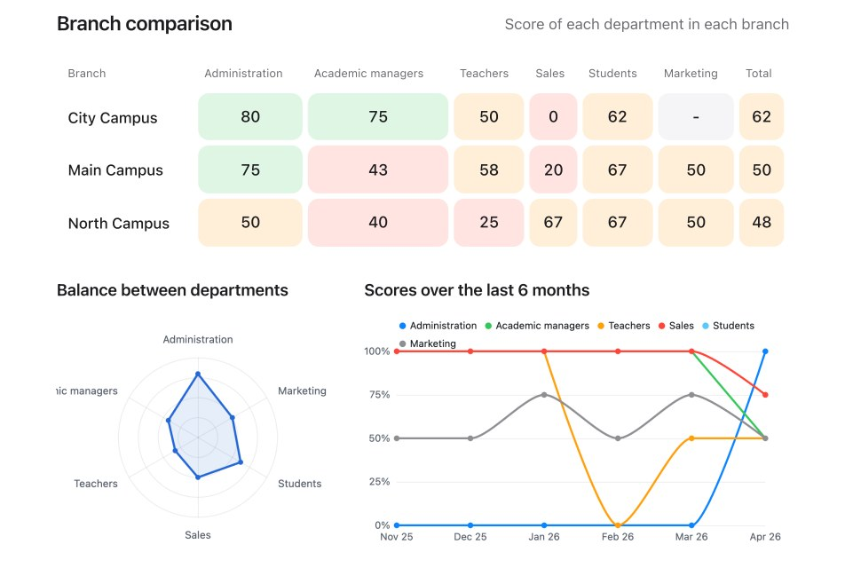

## Who uses it

| Role | What they get |
|---|---|
| **Owner** | The whole picture, final approval of decisions, and control of the AI assistant |
| **Quality manager** | Signals, decisions, reports, targets, checks, and users |
| **Branch manager** | Their own branch only |
| **Academic manager** | Teachers, observations, and academic results |
| **Sales manager** | Leads, consultants, and sales results |
| **Teacher or action owner** | Their own tasks and development record |

The six departments covered are Administration, Academic managers, Teachers, Sales, Students, and Marketing.

## How scores work

Every department has its own indicators, 34 in total. Each one is compared with a target that management agrees on, and weighted by its importance. The system also protects the score from weak data:

- An indicator without an agreed target isn't counted.
- A result based on too few cases is marked as a small sample instead of being judged.
- Each report states how many indicators its score rests on.
- Results that rely on estimated dates say so.

Management can change targets and importance from inside the system.

## AI assistant

Ai is the on-screen assistant, a character made of particles that form the letter i. **It drafts. You decide.**

**For reports,** it drafts an executive summary, highlights, risks, and recommendations. A person edits and approves them before they appear.

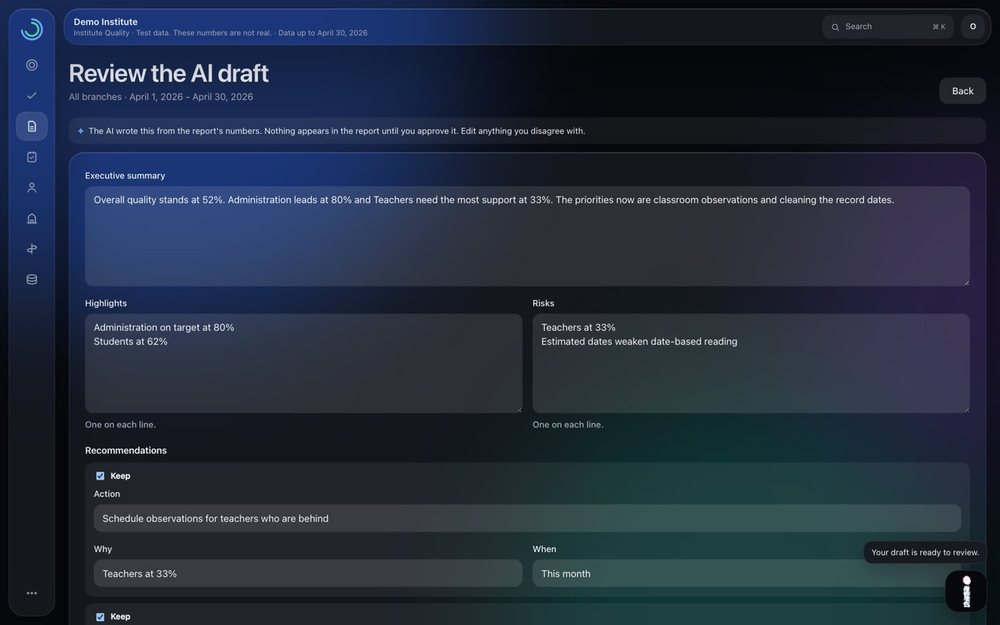

**For decisions,** it suggests likely causes with a way to check each one, and gives options with honest pros and cons, drawing on past decisions about the same problem.

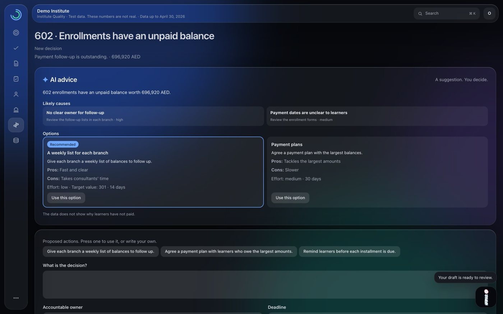

*These two screens show illustrative examples on test data.*

Three safeguards apply:

- **Human review:** nothing reaches a report or a decision without a person.
- **Number checks:** any number in a draft that isn't in the data is flagged for review.
- **Privacy:** names, phones, and emails of learners and staff never leave the system.

## Trust and privacy

- **Access by role and branch:** each person sees only what they should, and each institute's data stays separate.
- **Audit log:** every change is recorded and can't be edited.
- **Staff who leave:** their account stops, they drop out of current indicators, and their history stays.
- **Arabic and English:** the complete interface in both, with right-to-left support.
- **Any screen:** desktop and phone, light and dark.
- **Tested:** 250+ automated tests cover permissions, data separation, and the main workflows.

## Programming skills

| Area | Skills used |
|---|---|
| **Backend** | Python, Django, data modelling, role-based permissions, data separation between institutes |
| **Data** | Excel import with validation, calculating indicators, reports in PDF and Excel |
| **Frontend** | JavaScript, HTML, CSS, responsive design, right-to-left layouts, print design |
| **Data visualization** | Apache ECharts, cross-filtering charts, Canvas particle animation, 3D-style SVG maps |
| **AI integration** | LLM integration, structured outputs, removing personal data before sending, human review flows |
| **Quality** | Automated testing with pytest, audit logging, translation into Arabic and English |

## Status

All screens and numbers here come from **test data**. The system hasn't run on real institute data yet, so no real-world results are claimed. The AI assistant is in final testing.

<strong>بالعربي: الشرح الكامل</strong>

## Institute Quality

**نظام جودة يحوّل بيانات المعهد إلى قرارات يمكن التحقق منها.**

### المشكلة
تجمع المعاهد بيانات كثيرة في ملفات منفصلة. فالتقارير تصل متأخرة، والمشكلات تبقى بلا مسؤول، ولا يعرف أحد هل نجح القرار.

### الفكرة
1. **البيانات:** ترفع ملف Excel، فيفحصه النظام قبل أن تعتمده.
2. **الإشارة:** تكشف 22 قاعدة المشكلات وحجمها وسجلاتها.
3. **القرار:** لكل قرار مسؤول واحد وموعد وهدف يمكن قياسه.
4. **الإجراء:** تظهر الخطوات في مهام كل شخص.
5. **التحقق:** يؤكد العمل شخص لم ينفذه.
6. **الأثر:** تبين الأرقام قبل وبعد هل نجح القرار.

### أهم الشاشات
- **مركز الجودة:** الأقسام الستة في شاشة واحدة، وبماذا تبدأ.
- **النظرة العامة:** اضغط أي جزء في أي رسم لتصفية الصفحة كلها.
- **الفروع:** خريطة ثلاثية الأبعاد للإمارات، وأبراج تقارن الأقسام والفروع.
- **المبيعات:** من المهتم حتى التجديد.
- **القرارات:** الإشارات والأدلة ودورة القرار كاملة.
- **المدرسون:** صفحة تطوير لكل مدرس، والملاحظة الصفية داخل النظام.
- **التقارير:** للمعهد أو لكل فرع وقسم، بصيغة PDF وExcel، والمُصدر منها لا يتغير.

### المساعد آي
شخصية من جزيئات تشكل حرف i، **يكتب المسودة وأنت تقرر**. لا يظهر شيء قبل مراجعة إنسان، ويُنبّه إلى أي رقم غير موجود في البيانات، ولا تخرج الأسماء والهواتف والبريد من النظام أبدًا.

### الثقة
صلاحيات حسب الدور والفرع، وسجل تدقيق لكل تغيير، وواجهة كاملة بالعربية والإنجليزية، على الكمبيوتر والموبايل.

### المهارات البرمجية
Python وDjango، وتصميم البيانات والصلاحيات، وJavaScript وHTML وCSS، والرسوم التفاعلية، ودمج الذكاء الاصطناعي، والاختبارات الآلية بـ pytest، ودعم العربية والإنجليزية.

### الحالة
كل الشاشات والأرقام هنا من **بيانات تجريبية**، ولم يعمل النظام بعد على بيانات حقيقية. والمساعد في مرحلة الاختبار الأخيرة.

---

**About the source code:** the code for this system is private. This page explains what it does and how it works, without internal details. To talk about the work, contact me through my [GitHub profile](https://github.com/SamerAlTaki97).
